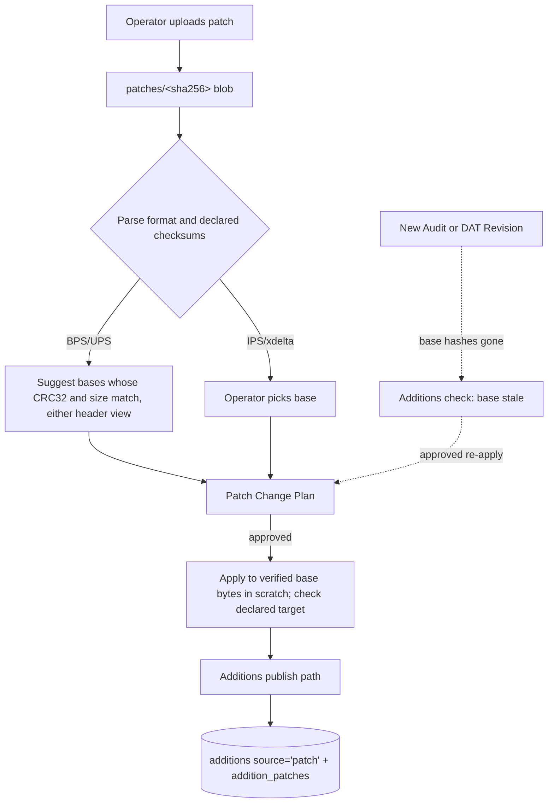

# Patches: producing Additions from an Operator-supplied patch

Findings for #106, part of #3. Researched 2026-11-14 against sources pinned to a commit: this repo at `c41633a`,
igir at `f0766c89`, oxyromon at `9c631bda`, RomM at `a19957e3`, and the format references cited in the companion
note [0106-rom-patch-format-specs.md](0106-rom-patch-format-specs.md). No Source Set, Host or Operator data was read,
and no request went to No-Intro or DAT-o-MATIC. **Inference** marks conclusions the sources don't state directly.

#106 asks whether Title Select should apply IPS, BPS, UPS or xdelta patches to Verified Games to produce Additions, as
igir does; what provenance such an Addition would record; and whether it would be rebuilt when its base changes.

## Recommendation

**Staged go. Don't patch in Title Select yet; make the Ingest path patch-aware now, and keep an in-house `patch`
Addition source designed but unbuilt.**

1. **Now: an ingest guard (~150 lines with tests).** Recognise patch files by extension and signature (`PATCH`,
   `UPS1`, `BPS1`, VCDIFF magic) during Ingest assessment and stop proposing them as Addition candidates. Today a
   dropped `.bps` that matches nothing becomes an Addition candidate itself (§1). Document the workflow "patch in
   RomM or any patcher, download the output, drop it into an Ingest Folder". The patched file then becomes an
   ordinary Addition identified by its own hashes.
2. **Later, only if it starts to matter: an in-house `AdditionSource::Patch` (§6).** It buys verified bases,
   provenance (base ROM hashes, patch SHA-256) and re-apply when a base changes, for about 1,200–1,600 production
   lines. The guard carries over as its "use as a patch" entry point.
3. **Never give RomM write access to the Play Library.** RomM's "Upload to RomM" writes only into the Play Library,
   which research 0005 mounts `:ro` for RomM (§5).

Why:

- RomM 5.0+ already applies ten patch formats server-side, including xdelta and ZIP members (§4). For "try a hack
  and play it now" it is the right tool, and delegating saves roughly 1,600–2,000 lines (about 1.5% of the repo).
- What delegating loses is exactly what an in-house source would add: RomM applies on a base mismatch, records no
  base or patch, and can't re-apply. Those are only worth building once the Operator keeps patched games as curated
  Library content rather than one-off downloads.
- RomM can't notify Title Select of a new patched file (§5), so an Ingest Folder, which Title Select already scans
  and settles (ADR 0008), is the only integration that needs no new code.

Answers to #106's three questions:

| Question | Answer |
|---|---|
| Apply patches, as igir does? | Not yet. Ingest the output of an outside patcher; build the `patch` source later (§6). |
| What provenance? | If built: base ROM by full hashes plus DAT Revision and name, patch SHA-256, the patch's declared checksums, header view. Via Ingest: only the output's own hashes. |
| Rebuilt when the base changes? | Never silently. Flag a stale base; re-apply only through an approved Change Plan (§6.4). |

## 1. What Title Select has today

- **Additions** have three sources: an Ingest item that matched nothing, Drift in a Library Folder, and a Source Set
  Entry no DAT knows (`crates/api/src/additions.rs:18-26`). Migration 0012 enforces one link column per source with
  CHECK constraints (`crates/store/src/migrations/0012_additions.sql:65-100`).
- An Addition is identified by its own hashes. `parent_game` is free text with no foreign key and no DAT validation
  (`crates/api/src/additions.rs:116-120`, `crates/store/src/additions.rs:408-412`).
- `check_additions` compares the folder only with each Addition's publish snapshot; it never reads a DAT
  (`crates/store/src/additions.rs:1188-1283`). Builds re-verify the published SHA-256 and fail loudly on a change;
  nothing is regenerated (`crates/store/src/builds.rs:588-646`).
- Retire frees the name slot, so "retire, then approve a new Addition with the same name" already works as two
  manual actions (`crates/store/src/additions.rs:1057-1148`).
- **Gap:** Ingest has no patch awareness. It rejects only `rar`; a raw patch that matches nothing is proposed as an
  Addition (`crates/store/src/ingest.rs:46`, `806-900`).
- ADR 0016: no Repair or Build strips a Header. ADR 0003 names only DAT blobs. The repo is MIT, so GPL and AGPL
  patch code can't be linked.

## 2. Tool landscape

| Tool | Patch role | Base pairing | Output and tracking | Licence |
|---|---|---|---|---|
| igir | Hard-patches during copy/move/zip | CRC32 only: BPS/UPS footer, otherwise an 8-hex token in the patch filename | Synthetic clone Game named after the patch, CRC32-only hashes | GPL-3.0 |
| oxyromon | Tracks only, never applies | Operator picks the ROM | `patches` rows; RetroArch sidecars `rom.ips`, `rom.ips1`… | GPL-3.0 |
| RomM | Hard-patches server-side (5.0+) via Rom Patcher JS | Checks embedded checksum, **applies anyway** | Download, or upload into the library as a new ROM | AGPL-3.0 |
| Rom Patcher JS | Applies and creates many formats | `validateSource`; user toggles header | Plain file | Open source |
| Flips | Applies and creates IPS/BPS | BPS footer CRCs | Plain file | GPL-3.0 |
| RetroArch | Soft-patches in memory | Same basename beside the ROM | Nothing written | GPL-3.0 |
| RomVault, clrmamepro, Retool, ES-DE | None | — | DAT-driven only | — |

### igir

- **Formats:** IPS/IPS32/EBP, UPS, BPS, PPF, APS, BSDiff, DPS, NINJA/RUP, PMSR, VCDIFF (LZMA secondary only),
  dispatched by extension then signature (`src/factories/patchFactory.ts:25-126`).
- **Pairing:** BPS and UPS read `crcBefore`/`crcAfter` from the footer; every other format needs a CRC32 token in its
  filename (`src/models/patches/patch.ts:33-39`). Patches are matched against DAT-matched candidates only.
- **Output:** named from the patch filename; the Game is cloned with MD5/SHA-1/SHA-256 cleared and CRC32 set from
  `crcAfter`, and re-verified after write only when the format declares it
  (`src/modules/candidates/candidatePatchGenerator.ts:160-219`, `candidateWriter.ts:793-848`).
- **Limits:** no chaining (emmercm/igir#422); headers not tried both ways for patches (emmercm/igir#806).

**Inference:** igir's identity model (CRC32 pairing, filename conventions, synthetic DAT clones) conflicts with two
rules here: an Addition is identified by full hashes, and it is never an official DAT match. Borrow igir's format
coverage and its use of the patch's embedded checksum, not its identity model.

## 3. Formats and headers

Detail is in [0106-rom-patch-format-specs.md](0106-rom-patch-format-specs.md). In short:

| Format | Source check | Target check | Patch check |
|---|---|---|---|
| BPS | CRC32 + size | CRC32 + size | CRC32 |
| UPS | CRC32 + size | CRC32 + size | CRC32 |
| IPS / IPS32 | none | none | none |
| xdelta3 / VCDIFF | optional per-window Adler-32 | — | — |
| PPF 1–3 | v3 optional 1 KB block | — | — |
| RUP / NINJA2 | MD5 | MD5 | — |

- Only BPS and UPS let a tool verify the base before applying and the output after. With IPS the Operator's choice
  of base has to stand in for verification.
- Hack sites publish the expected base: romhacking.net (read-only since August 2024) lists headered and headerless
  SHA-1/CRC32 and the DAT name; Romhack Plaza lists CRC32/SHA-1 and a verified DAT variant.
- Many SNES IPS patches expect a 512-byte copier header; NES patches may expect iNES. Under ADR 0016 any header
  add/remove must be an in-memory view for applying, never a change to stored bytes.
- Ordered chains (a base translation plus addenda) are a known need no mainstream tool does first-class.
- Disc hacks usually ship xdelta against one Redump track plus an edited cue; the result leaves the DAT entirely.
- Patches are distributed separately from ROMs. Title Select should accept only Operator-supplied patches and never
  fetch them, in the spirit of ADR 0012.

## 4. RomM's patcher

| Aspect | Behaviour at `a19957e3` |
|---|---|
| Endpoint | `POST /api/roms/{file_id}/patch`, scope `roms.read`; a library patch or an uploaded one (never stored) |
| Formats | ips, ups, bps, ppf, rup, aps, bdf, pmsr, vcdiff, xdelta |
| Base check | Computed, but applied anyway (`requireValidation: false`); result in an `X-Patch-Validated` header and a UI warning |
| Headers | Rom Patcher JS header and checksum-fix options hard-coded off |
| Archives | ZIP member patched and the ZIP rebuilt; 7z/RAR rejected |
| Limits | One patch per call, no chaining; 4 GiB input, 120 s timeout, 2 concurrent jobs |
| Output | `<rom> (patched-<patch>)<ext>` unless renamed |
| Save | "Upload to RomM" uses the ordinary upload into `games_dir(fs_slug)`; destination not choosable; name collision is HTTP 400 |
| Provenance | None stored; the patch step isn't audit-logged |

rommapp/romm#2942 (open) still asks for hash-match verification before upload.

## 5. Using RomM instead: trade-offs

**The Play Library write problem.** Research 0005 found RomM runs correctly with the Play Library mounted `:ro`, and
every write path fails cleanly; uploads share those primitives (**Inference** for upload specifically). Making
"Upload to RomM" work means making the Play Library writable for RomM. A foreign write there becomes a Conflict that
the next Build skips (overwrite) or Unknown Drift (new file), and becomes an Addition only through an approved
Cleanup with `AddAddition` (`crates/store/src/checks.rs:420-563`, `crates/store/src/builds/cleanup.rs`). That works,
but reverses research 0005 and the glossary rule that Title Select alone writes Library Folders.

**The supported landing zone is an Ingest Folder** (ADR 0008: settle interval, durable intent). RomM can't target
one, so the flow is: patch in RomM, download, drop into an Ingest Folder.

**Notification.** RomM can't tell Title Select that a patched ROM exists:

- Notification kinds cover scans, tasks, streaming sessions, roles, channels, devices and `custom`; there is no "ROM
  added" kind (`backend/models/notification.py:17-47`).
- The upload path emits no socket event, notification or webhook; scan socket events fire only during a scan, and
  `scan_completed` carries totals, not ROM IDs. There is no plugin or post-upload hook.
- Polling would work: a Client API Token with `roms.read` can list `GET /api/roms?order_by=id&order_dir=desc`, and
  each file exposes its path and CRC/MD5/SHA-1. A patched upload is recognisable only by its `(patched-…)` name.
  Whether `updated_after` is a public parameter is unverified.

With output landing in an Ingest Folder none of this is needed.

**Losses accepted by delegating:** wrong-base outputs become Additions silently; nothing records the base or patch;
nothing flags or re-applies when the base changes; no ordered chains.

### Size of each option

| Option | Production lines | Test lines | Main pieces |
|---|---:|---:|---|
| Title Select applies patches | ~1,190–1,560 | ~430–610 | IPS/UPS/BPS (~470–550), apply-and-verify stage (~150–190), UI (~300–380), Job kind (~80–130), upload and blobs (~100), provenance and stale-base check (~120–150) |
| Outside patcher, output via Ingest | ~70–110 | ~40–60 | Patch guard in Ingest assessment, docs |

For scale: 88k production and 30k test lines of Rust at `c41633a`; the Additions PR (#54) added 7,346 lines. Parser
sizes are estimated from Flips, igir and Rom Patcher JS, since no patch code exists here.

### Which tool for which job

| Need | Tool |
|---|---|
| Try a hack once, play it now | RomM (download) |
| Kept, verified, rebuilt hacks in the Play Library | Title Select |
| A base guaranteed correct (BPS/UPS refuse a mismatch) | Title Select |
| PPF, APS, RUP at low cost | RomM |

## 6. Deferred design: `AdditionSource::Patch`

Recorded so the later stage starts from an agreed shape. **Inference** throughout: none of this is decided.

### 6.1 Flow

### 6.2 Data model

- Add `Patch` to `AdditionSource` and a `patch_plan_id` link column with a matching CHECK, mirroring the other three.
- Add `addition_patches(addition_id, seq, patch_sha256, format, declared_source_crc32, declared_source_size,
  declared_target_crc32, declared_target_size, header_view)`; `seq` allows ordered chains later.
- Record the base by full hashes plus `base_dat_revision_sha256`, `base_game`, `base_rom_name`. Game identity across
  DAT Revisions is name-only today (`crates/engine/src/dat.rs:31-50`), so hashes are the stable anchor.
- Keep `parent` metadata-only, defaulting to the base Game.
- Store patches as content-addressed blobs under `patches/<sha256>`, reusing `write_blob` and the `POST /dats`
  multipart shape (`crates/store/src/blobs.rs`, `crates/server/src/routes.rs:420-448`). Needs an ADR, since ADR 0003
  names only DAT blobs.

### 6.3 Verification

1. The base ROM's latest Audit has `EvidenceLevel::Payload`.
2. BPS/UPS: reject (not warn, as RomM does) when the declared source CRC32 and size match neither the stored bytes nor
   the headerless view, or when the output doesn't match the declared target. A patch failing its own CRC is invalid.
3. IPS/xdelta: the Operator's chosen base stands in; record `source_verified = false` and show it.
4. Hash the output fully and publish through the existing Additions Job with the storage policy.

### 6.4 Rebuild semantics

No automatic rebuild: Additions stay static and Builds keep failing loudly on a changed file. Add a check that flags a
patch-derived Addition whose base hashes no longer appear in any Audit of its system. Re-apply is an approved Change
Plan that retires the old Addition and applies the stored patch blobs to the new base under the same name; no
re-upload is needed.

### 6.5 Phasing

| Phase | Includes |
|---|---|
| 1 | BPS, UPS, IPS in-house (MIT, ~130–220 lines each); single-ROM cartridge systems; one patch per Addition |
| 2 | Ordered chains; xdelta via `xdelta-rs` (Apache-2.0, pinned and vetted) |
| Not planned | Disc patching, PPF, RetroArch soft-patch sidecar export |

GPL and AGPL crates (`flips`, `xps-rs`, `rom-weaver-*`) are excluded by the licence; `ips` and `ups` exist but are
dormant and partial.

## Open questions

1. Ingest guard copy: does a detected patch get its own Ingest outcome ("patch, not a game") or simply no proposal?
2. If §6 is built: re-attach the base's header to the output or not, and which ADR governs Addition bytes.
3. Patch blobs: generalise ADR 0003 or a new ADR.
4. A new `JobKind::Patch`, or an apply step before the existing Additions publish.
5. Allow IPS with no verifiable base at all, or only behind explicit confirmation.
6. Could a Selection ever prefer a patched Addition over its base (a translation over a Japanese original)? Today
   `parent` never changes a Selection.

## Sources

- This repo at `c41633a`: `GLOSSARY.md` (Addition, Library Folder, Drift); ADRs 0003, 0008, 0012, 0013, 0016;
  research 0005; `crates/api/src/additions.rs`, `crates/api/src/lib.rs:566-595` (`JobKind`),
  `crates/store/src/additions.rs`, `crates/store/src/ingest.rs`, `crates/store/src/builds.rs`,
  `crates/store/src/checks.rs`, `crates/store/src/migrations/0012_additions.sql`; #3, #19, #39, #54, #106.
- igir at `f0766c89`:
  [patch.ts](https://github.com/emmercm/igir/blob/f0766c894eae36ab8538e1e958fca70982f5d828/src/models/patches/patch.ts#L33-L63),
  [patchFactory.ts](https://github.com/emmercm/igir/blob/f0766c894eae36ab8538e1e958fca70982f5d828/src/factories/patchFactory.ts#L25-L126),
  [candidatePatchGenerator.ts](https://github.com/emmercm/igir/blob/f0766c894eae36ab8538e1e958fca70982f5d828/src/modules/candidates/candidatePatchGenerator.ts#L65-L219),
  [candidateWriter.ts](https://github.com/emmercm/igir/blob/f0766c894eae36ab8538e1e958fca70982f5d828/src/modules/candidates/candidateWriter.ts#L793-L848);
  emmercm/igir#422, emmercm/igir#806.
- oxyromon at `9c631bda`:
  [import_patches.rs](https://github.com/alucryd/oxyromon/blob/9c631bda99c375c3c141838db43182cf174ee731/src/import_patches.rs#L18-L208),
  [sort_roms.rs](https://github.com/alucryd/oxyromon/blob/9c631bda99c375c3c141838db43182cf174ee731/src/sort_roms.rs#L827-L838).
- RomM at `a19957e3`:
  [patch.py](https://github.com/rommapp/romm/blob/a19957e33c2546e58dfa7e90dfa03a05691ad0c0/backend/endpoints/roms/patch.py#L35-L213),
  [patcher.js](https://github.com/rommapp/romm/blob/a19957e33c2546e58dfa7e90dfa03a05691ad0c0/backend/utils/rom_patcher/patcher.js#L73-L106),
  [roms_handler.py](https://github.com/rommapp/romm/blob/a19957e33c2546e58dfa7e90dfa03a05691ad0c0/backend/handler/filesystem/roms_handler.py#L493-L508),
  [upload.py](https://github.com/rommapp/romm/blob/a19957e33c2546e58dfa7e90dfa03a05691ad0c0/backend/endpoints/roms/upload.py#L333-L348),
  [notification.py](https://github.com/rommapp/romm/blob/a19957e33c2546e58dfa7e90dfa03a05691ad0c0/backend/models/notification.py#L17-L47);
  [Rom Patcher docs](https://docs.romm.app/latest/using/rom-patcher/),
  [notifications](https://docs.romm.app/5.4.0/using/notifications/),
  [API authentication](https://docs.romm.app/5.4.0/developers/api-authentication/); rommapp/romm#2942.
- [marcrobledo/RomPatcher.js](https://github.com/marcrobledo/RomPatcher.js), [Alcaro/Flips](https://github.com/Alcaro/Flips),
  [libretro soft-patching](https://docs.libretro.com/guides/softpatching/).
- romhacking.net via the Internet Archive
  ([hack 6908](https://web.archive.org/web/20230928040943/https://www.romhacking.net/hacks/6908/),
  [FAQ](https://web.archive.org/web/20240801061327/https://www.romhacking.net/faq/)); Romhack Plaza hack pages.
- crates.io entries for `ips`, `ups`, `flips`, `xps-rs`, `xdelta-rs`, `oxidelta`, `xdelta3`, `rom-weaver-patches`.
